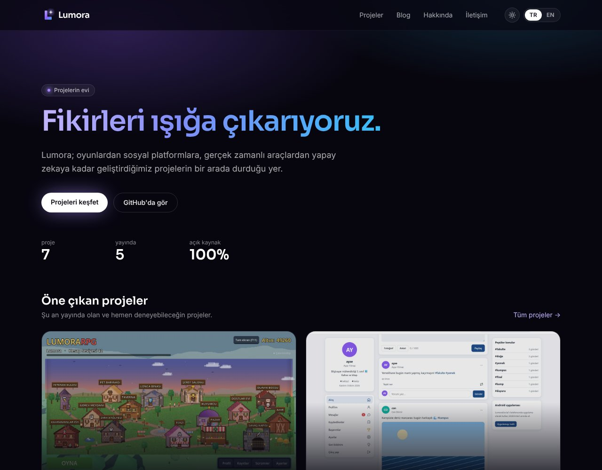
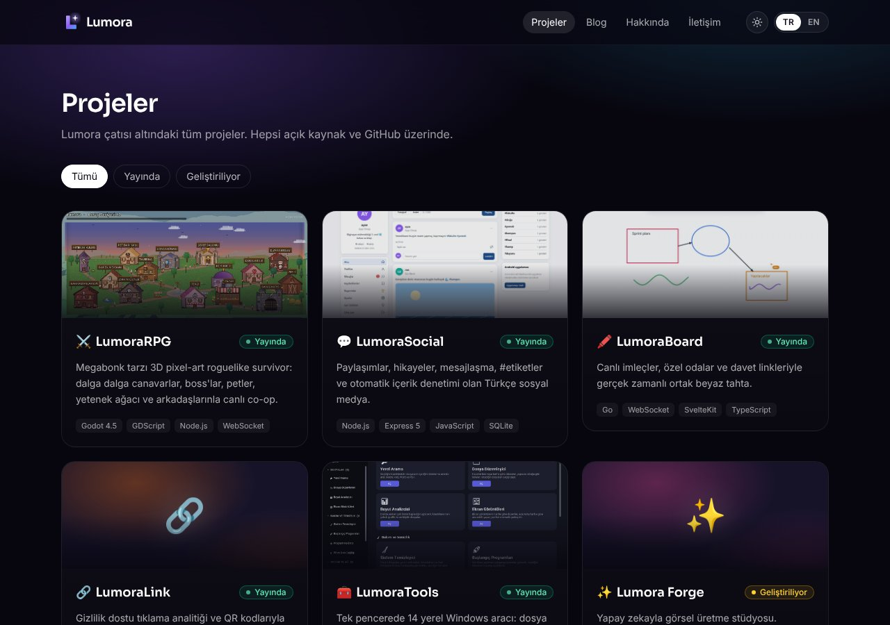
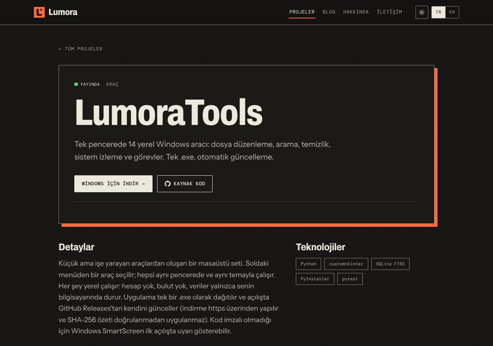
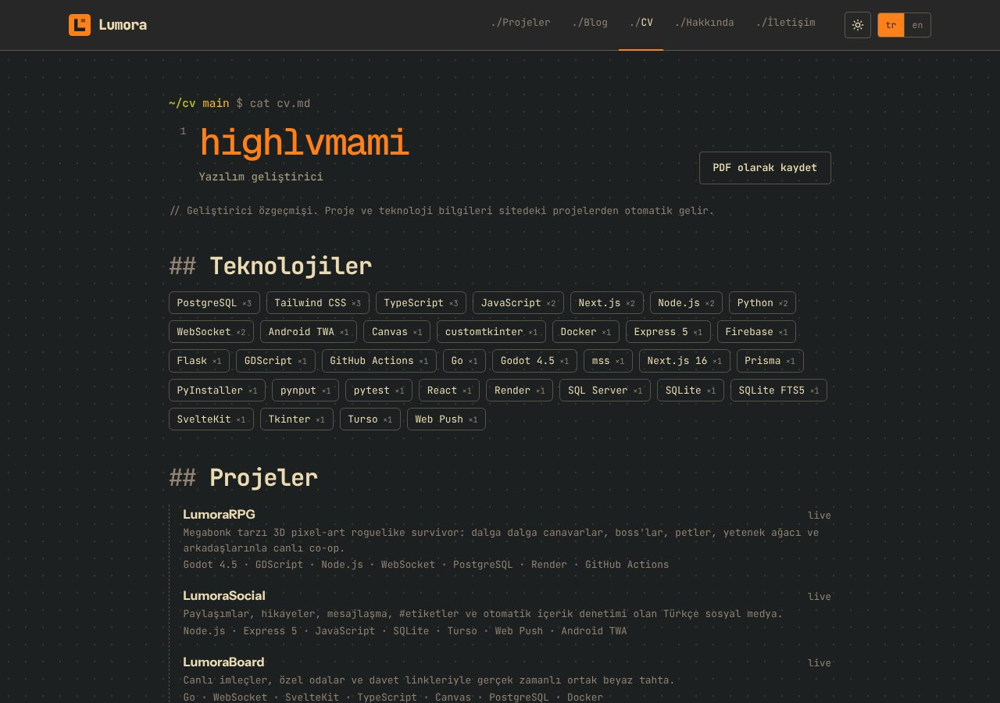
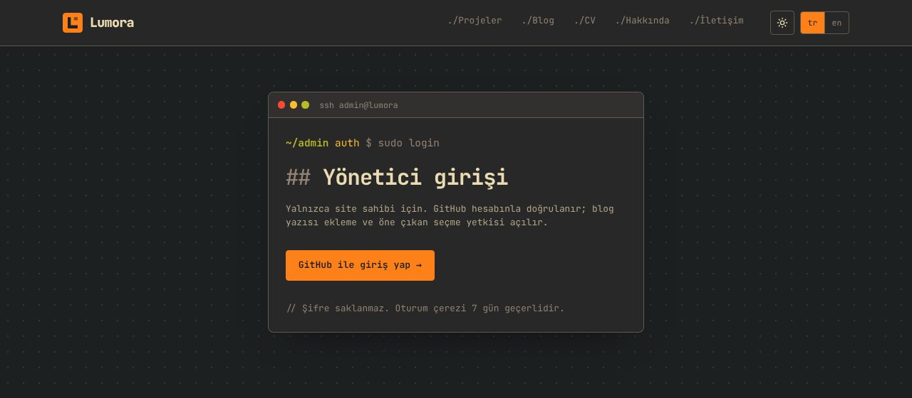
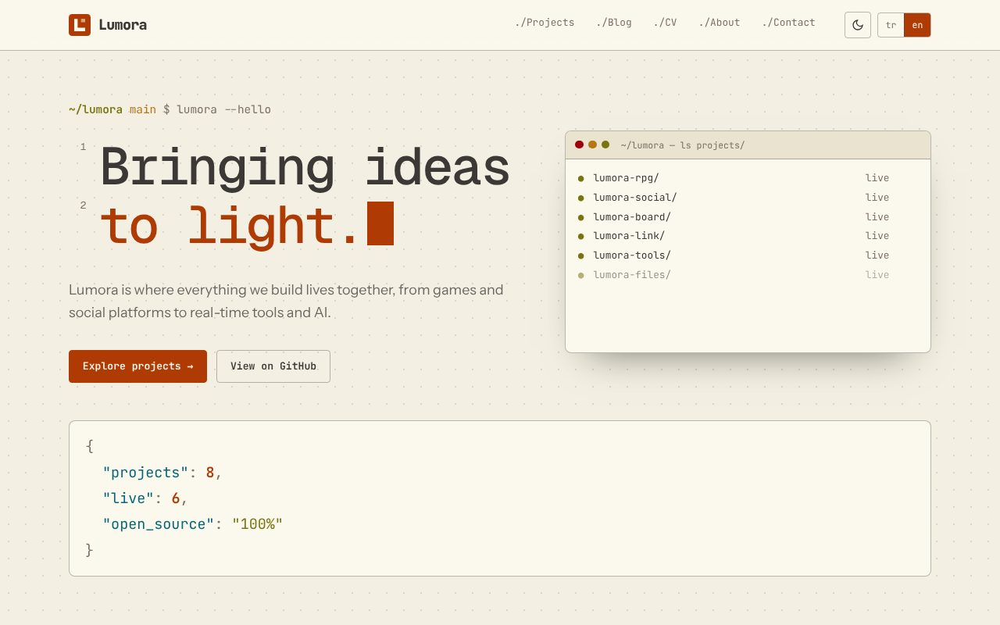
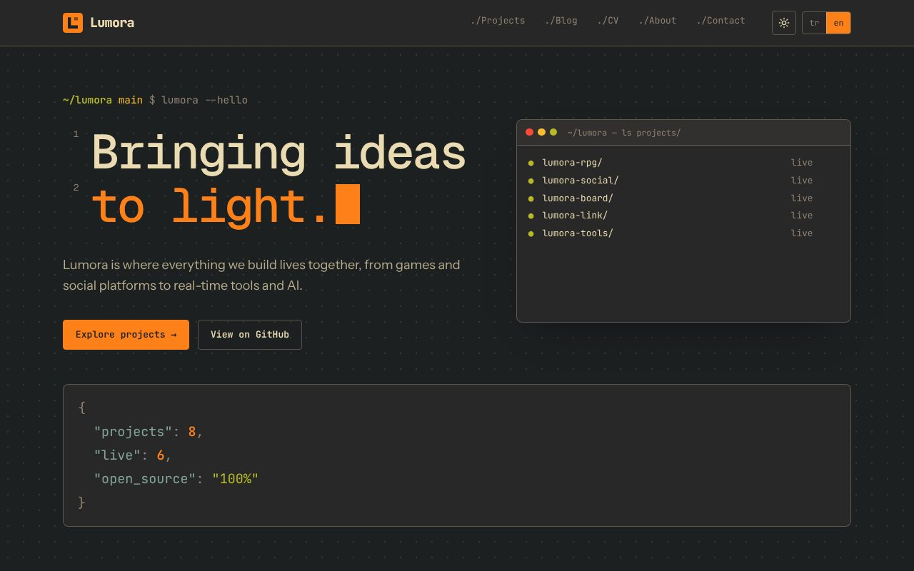
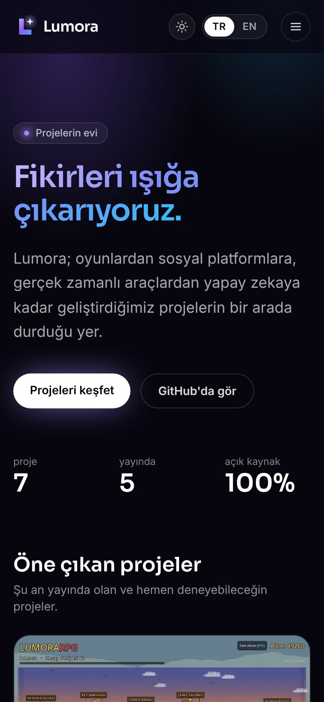

# Lumora

**Lumora projelerinin vitrin sitesi: oyunlar, sosyal ağlar, gerçek zamanlı araçlar ve daha fazlası tek yerde. Türkçe ve İngilizce, koyu ve açık tema, hızlı ve statik.**

**[Siteyi aç → lumorahub.pages.dev](https://lumorahub.pages.dev)**

Türkçe · [English](README.en.md)

  
  
  
  
  

Lumora, geliştirdiğimiz projelerin bir arada durduğu ana sitedir. Her projenin kendi sayfasında tanıtım metni, ekran görüntüleri, özellikler, kullanılan teknolojiler ve "Siteye git / İndir / Kaynak kod" bağlantıları bulunur. Yıldız sayısı, son güncelleme ve son sürüm bilgisi GitHub'dan otomatik çekilir ve her gün tazelenir. Site tamamen statiktir: çökecek bir sunucu yoktur, Cloudflare'in dünya çapındaki ağından servis edilir.

## Ekran görüntüleri

  

  
  

  
  

  
  

  

Ana sayfa · Projeler · Proje sayfası · CV · Yönetici girişi · Açık tema · İngilizce sürüm · Mobil görünüm

## Neler var

- **Projeler:** LumoraRPG, LumoraSocial, LumoraBoard, LumoraLink, LumoraTools, LumoraFiles ve LumoraGo yayında; Lumora Forge ve Lumora Academy geliştiriliyor.
- **İki dil:** Türkçe `/`, İngilizce `/en/`. Sağ üstteki TR | EN düğmesi aynı sayfanın diğer dilini açar, seçim hatırlanır ve ilk ziyarette tarayıcı diline göre yönlendirilir.
- **Yazılımcı sitesi görünümü:** terminal temalı ana sayfa, kod yorumu tarzı başlıklar, durum çubuğu altlık ve hafif animasyonlar (hareketi azalt ayarı açıkken kapanır).
- **CV sayfası:** teknolojiler ve projeler sitedeki projelerden otomatik gelir; "PDF olarak kaydet" düğmesiyle yazdırılabilir.
- **Yönetici girişi:** site sahibi GitHub ile girip blog yazısı ekleyebilir ve öne çıkan projeleri seçebilir.
- **Koyu ve açık tema:** sağ üstteki düğmeyle değişir, seçim tarayıcıda saklanır.
- **Blog:** duyurular, sürüm notları ve grafikli yazılar; Türkçe ve İngilizce.
- **GitHub bilgileri:** yıldız, son güncelleme ve son sürüm derleme sırasında çekilir; günlük otomatik yeniden derleme ile güncel kalır.
- **SEO ve paylaşım:** sitemap, hreflang, Open Graph görseli ve güvenlik başlıkları hazırdır.
- **Hızlı ve hafif:** sayfalar önceden HTML olarak üretilir, çerez ve takip betiği yoktur.

## Sayfalar

| Sayfa | Adres |
| --- | --- |
| Ana sayfa | `/` · `/en/` |
| Projeler ve proje detayları | `/projeler/` · `/en/projects/` |
| Blog | `/blog/` · `/en/blog/` |
| CV | `/cv/` · `/en/cv/` |
| Hakkında | `/hakkinda/` · `/en/about/` |
| İletişim | `/iletisim/` · `/en/contact/` |
| Yönetici girişi | `/giris/` · `/en/login/` |

## Teknolojiler

Astro, Tailwind CSS, TypeScript; Cloudflare Pages ve Pages Functions; yönetici girişi için GitHub OAuth, favoriler ve blog yazıları için Cloudflare KV.
